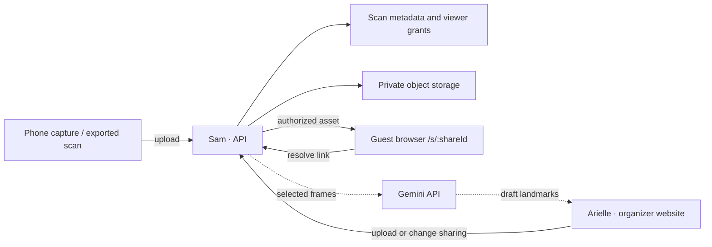

# Path App architecture

**First milestone:** An organizer uploads one real phone scan, chooses **Unlisted**, copies the link, and a teammate opens and orbits the scan on a second phone while signed out. Record the file size and time to first interactive view. A successful download proves transport. The second-phone test proves the user experience.

## System and ownership

The diagram below covers publication of a finished scan. The [offline website architecture](../planning/offline-web-product.md#architecture) adds camera capture, an on-device preview, resumable video ingest and a reconstruction worker ahead of publication.

| Area | Owner | First handoff |
| --- | --- | --- |
| [Website](../apps/web/README.md) | Arielle | Upload a fixture and render the returned asset by opening the share URL in a fresh browser session. |
| [API and storage](../services/api/README.md) | Sam | Persist scan bytes and sharing rules. Resolve a link after a server restart. |
| [Capture and processing](../apps/capture/README.md) | Krishna and Anish | Deliver one measured phone export, its format and orientation, plus a few original frames with stable IDs for the Gemini trial. |

The account system, framework and hosting provider are open choices. A practical starting stack is React, TypeScript and Three.js for the web, a same-origin HTTP API, Postgres for ownership and grants, and private object storage for large assets. The website can proxy `/api` to Sam’s service during development. Sam can choose Auth0 if pursuing its track, or use a bundled auth, database and storage service to reduce setup. The local mock is a disposable integration tool. [Three.js loaders](./scan-formats.md) · [Supabase private buckets](https://supabase.com/docs/guides/storage/buckets/fundamentals) · [Prize plan](./prize-plan.md)

## Sharing

| Visibility | Appears in public discovery | Who can open the link and load the scene |
| --- | --- | --- |
| Public | Yes | Anyone, including signed-out visitors |
| Unlisted (link only) | No | Anyone who receives the opaque link, including someone it was forwarded to |
| Private (invited viewers) | No | The owner and specific signed-in accounts with a viewer grant |

Use **Private** as the proposed default until the owner chooses an audience. The owner manages grants and visibility. A private invitee can view the scan. Store the scan’s owner, an opaque share ID, visibility, asset object key, format, byte size and processing state. A unique pair of scan ID and account ID represents each private viewer grant.

Keep the bucket private for every mode. Resolve the share page, metadata, thumbnail and asset request under the current sharing rule. The public index returns ready, public scans only. When the owner switches to private or revokes a viewer, recheck access on the next request, including direct asset requests. A server-proxied asset read makes this behavior straightforward for the demo. Bytes a viewer already downloaded remain on their device.

## Upload and publication

1. Verify the uploader’s session and record a pending upload owned by that account. Accept the file into staging. For large phone exports, Sam can switch to direct storage upload and finalize with an idempotent API call.
2. Check the stored bytes, format and parseability before marking a scan ready. A retry of finalization should resolve to the same scan. A failed upload stays out of discovery and can be retried or cleaned up.
3. Return a stable website path such as `/s/<shareId>`. The website resolves the share metadata and fetches the authorized asset to render. Keeping a website URL lets the team replace the storage backend without changing shared links.
4. In the later event workflow, store a contributed section as a draft. The organizer verifies alignment and approves a published event revision. Apply access checks to all included assets so adding a private scan to a public event cannot silently expand its audience.

## After the first share works

- **Landmarks and directions.** Keep selected RGB frames and their scan-local camera poses during capture. A geometry-only export can lose the original images. Start by matching a few frames to manually verified waypoints. Gemini suggests landmark names and visual cues for organizer review. [Gemini demo design](./gemini-demo.md)
- **QR and routing.** Each entrance QR identifies an event and a known starting waypoint. Destinations reference waypoints, and hosts connect walkable edges. Compute the shortest path by edge length and handle an unreachable destination in the viewer. The fixture uses a single event frame in meters, with +Y up. [Venue fixture and axes](../fixtures/README.md)
- **Contributions.** Test with one extra section. Before approval a guest sees the original venue. After approval the guest can open the same event link and see the new section aligned to a known anchor.

## Decisions to record during the hackathon

| Decision | Who resolves it | Evidence to put in the PR |
| --- | --- | --- |
| PLY or textured GLB for the first real scan | Krishna, Anish and Arielle | Same corridor on a second phone, recognizable landmark, correct scale, file size and load time. [Phone trial](./scan-formats.md) |
| Backend, identity provider and storage | Sam | Restart the service, reload the same link, then verify identity-based private reads and revocation on the raw asset. |
| First guest experience | Arielle | A guest can open the link, see the scan, rotate it and identify the intended turn without setup. |
| Which prize claims to submit | All four | A working feature and reproducible evidence from this weekend for each selected track. [Prize plan](./prize-plan.md) |
