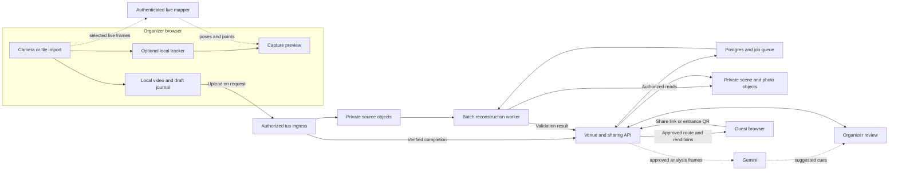

# Engineering Path from phone video to a navigable venue

**Decision for team review.** Build one website with two capture modes. Both save the full recording on the organizer’s phone. **On-device preview** works after the scanner has been prepared for offline use. **Live server preview** sends selected frames to a private mapping session while the organizer walks. Uploading the original and publishing the result are separate actions. Guests open an entrance QR or share link, choose a destination, and get approved directions, photos, and an optional 3D view.

**First integration target.** One ordinary phone, one permitted L-shaped hallway, one visible doorway and a second phone. A person unfamiliar with the venue must be able to recognize the turn in the shared 3D scene and follow the approved route. Record observed results separately for capture, live preview, final reconstruction and guest use. [Product flow and qualification matrix](../planning/offline-web-product.md) · [Team board](https://github.com/darkprince558/path-app/issues/8)

## 1. What the team needs

| Need | Concrete starting choice | Owner and evidence before expanding |
| --- | --- | --- |
| Web client | Build on Arielle’s Vite, React, TypeScript, React Three Fiber, Three.js, and QR code components in `apps/web/`. Reuse `/upload`, `/s/:shareId`, sharing controls and the PLY renderer. Add `/capture`, the device draft list, a route editor, and a lightweight directions view. | Arielle. The organizer branch accepts PLY/GLB uploads. Its guest viewer renders PLY and shows an unsupported-format state for GLB. Exercise the exact export on a phone before selecting a new renderer. [Branch package](https://github.com/darkprince558/path-app/blob/ad4f3bebe1542e4e568e7b5eb4bbb64d185f1b36/apps/web/package.json) · [Branch integration notes](https://github.com/darkprince558/path-app/blob/ad4f3bebe1542e4e568e7b5eb4bbb64d185f1b36/apps/web/README.md) |
| Field equipment | One ordinary camera phone, a second physical phone for the guest, one measured scale reference and an independent check distance. Get venue permission for the route and photographs. Include iPhone Safari and Android Chrome across the trials. | Krishna and Anish. Keep real captures private. Share a synthetic equivalent in Git and report device, OS/browser, lighting and network. |
| Browser capture | HTTPS camera access, MediaRecorder, IndexedDB for draft metadata and ordered chunks, service worker for the scanner shell, and a Web Worker for optional downscaled tracking. Prototype `visloc-rs` on the actual devices. | Krishna owns capture processing and Arielle owns website integration. Check recording continuity, offline reopen, tracking latency, calibration and motion-permission fallback before enabling a device tier. [Recording specification](https://www.w3.org/TR/mediastream-recording/) · [WebKit storage](https://webkit.org/blog/14403/updates-to-storage-policy/) · [Browser tracking prototype](https://rsasaki0109.github.io/visloc-rs/slam/) |
| API, identity and durable data | One same-origin API. Python/FastAPI is the proposed starting implementation for Sam’s service. Use an OIDC provider such as the proposed Auth0 tenant, a server session, Postgres, private S3-compatible storage and a self-hosted tusd upload endpoint. | Sam. Establish one team HTTPS origin, callback configuration, bucket, database backup, and separate service credentials for ingest and workers. Restore a share after restart and deny a revoked viewer’s next asset read. [Deployment baseline](deployment.md) · [tus protocol](https://tus.io/protocols/resumable-upload) |
| Reconstruction and serving | PyAV/FFmpeg for decoding, PyCOLMAP for camera poses and sparse geometry, Brush for the first splat trial on the team Mac. Use an isolated Linux worker with gsplat if GPU benchmarks justify it. Spark is the proposed web splat renderer. | Krishna and Anish own the reconstruction recipe. Sam operates the queue. Arielle qualifies renditions on mobile. Pin the working decoder, libraries, model licenses where applicable and GPU driver/container combination in the first reproducible worker build. [COLMAP](https://colmap.github.io/tutorial.html) · [Brush](https://github.com/ArthurBrussee/brush) · [gsplat](https://docs.gsplat.studio/main/examples/colmap.html) · [Spark](https://sparkjs.dev/docs/lod-getting-started/) |
| Optional AI and operations | A backend Gemini key for organizer-selected landmark images, a spend ceiling, storage lifecycle settings, minimal operational metrics and a named deployment owner. | Sam and Anish choose the host, region, retention and budget with the venue owner. A manual landmark cue and the first physical 3D test can proceed before Gemini setup or cloud GPU rental. [Gemini review flow](gemini-demo.md) |

**What exists today.** Main contains the synthetic venue and an in-memory sharing service. The guest viewer and organizer flow have separate branch checkpoints on desktop Chromium at mobile dimensions. The ARKit experiment used synthetic output and a simulator. The proposed browser scanner, hosted worker, physical phone reconstruction, server-mode latency, and offline draft recovery each need their own evidence. [Viewer checkpoint](https://github.com/darkprince558/path-app/issues/2#issuecomment-7057388724) · [Organizer checkpoint](https://github.com/darkprince558/path-app/issues/13#issuecomment-7057554875) · [Capture checkpoint](https://github.com/darkprince558/path-app/issues/4#issuecomment-7057179801)

## Library choices at a glance

| Job | Dependency to use | Adoption status |
| --- | --- | --- |
| Website, navigation, QR and ordinary 3D | `react`, `react-router`, TypeScript, Vite, `three`, `@react-three/fiber`, `@react-three/drei`, `qrcode.react` | Already declared on Arielle’s organizer branch. Extend its point-cloud renderer. [Package manifest](https://github.com/darkprince558/path-app/blob/ad4f3bebe1542e4e568e7b5eb4bbb64d185f1b36/apps/web/package.json) |
| Camera, local media and offline shell | Browser `getUserMedia`, `MediaRecorder`, service worker, Cache API and IndexedDB. Use npm `idb` for draft transactions. | Proposed baseline. Cache the website shell separately from the user’s recorded files. [idb](https://github.com/jakearchibald/idb) |
| Offline camera tracking | `visloc-rs` compiled to WebAssembly in a Web Worker, reading downscaled frames and permitted motion data. | Prototype on iOS and Android. Keep saved frames as the fallback. [Tracker and phone demo](https://rsasaki0109.github.io/visloc-rs/slam/) |
| Private live mapping | Browser WebSocket, FastAPI WebSockets, Python `pycolmap` plus Path’s session, frame selection and incremental map code. | Prototype. Benchmark frame-to-display latency with a stateful streaming adapter around COLMAP. [FastAPI](https://fastapi.tiangolo.com/advanced/websockets/) · [PyCOLMAP](https://colmap.github.io/pycolmap/) |
| Resumable transfer | npm `tus-js-client` in the browser and the self-hosted `tusd` service with private object storage. | Proposed. Persist local upload handles, enforce owner access on every operation, and check the server offset after interruption. [Client](https://github.com/tus/tus-js-client) · [Server](https://github.com/tus/tusd) |
| Final video-to-3D pipeline | Python `av` (PyAV, backed by FFmpeg) for decoding and presentation timestamps, `pycolmap` for registration and sparse points, then headless Brush on the Mac. For Linux/NVIDIA, evaluate PyTorch + `gsplat`. | Proposed. Brush and gsplat are alternative trainers for the same proved capture. [PyAV](https://github.com/PyAV-Org/PyAV) · [Brush](https://github.com/ArthurBrussee/brush) · [gsplat](https://docs.gsplat.studio/main/examples/colmap.html) |
| Scene rendering and directions | Three.js `PLYLoader` + `Points` for point clouds, `@sparkjsdev/spark` for Gaussian splats, `GLTFLoader` when mesh support ships. A small TypeScript Dijkstra implementation reads the verified waypoint graph. | PLY viewer exists on the branch. Qualify Spark against the branch’s Three.js peer version and keep one Three.js runtime. Deliver HTML steps and photos independently. [Spark](https://github.com/sparkjsdev/spark) · [Fixture graph](../fixtures/README.md) |
| Backend, persistence, AI and tests | FastAPI/Uvicorn, SQLAlchemy, psycopg 3, Alembic, PostgreSQL and private object storage. Use the server-side `google-genai` Python SDK for optional cue suggestions. Playwright for browser integration plus physical-device checks. | Proposed. Use Postgres for durable job claims at pilot scale. The OIDC provider and GPU host are deployment choices. [SQLAlchemy](https://docs.sqlalchemy.org/en/20/) · [Alembic](https://alembic.sqlalchemy.org/en/latest/) · [Google Gen AI SDK](https://github.com/googleapis/python-genai) · [Playwright](https://playwright.dev/docs/emulation) |

## 2. Where each component runs



The proposed demo deployment uses Caddy for HTTPS and a single web/API host with Postgres and private object storage. Proxy `/api/`, the tus upload paths and the live WebSocket on the same origin. The API authenticates the opening handshake and every upload request. Give the live mapper an expiring session and a bounded input buffer. Run video decoding and batch reconstruction in a separate process with bounded CPU, memory, scratch disk and wall time. A failed training run should leave recording, guest reads and published routes available. The project’s proposed Vultr web host and a local or rented worker can be chosen independently. [Deployment plan](deployment.md) · [Caddy HTTPS](https://caddyserver.com/docs/quick-starts/https)

## 3. Scanner and live session

| State or action | Browser and server behavior |
| --- | --- |
| Prepare once online | Cache versioned scanner assets and tracking weights/code as applicable. Mark **Ready for offline capture** after checking availability and performing a local storage write. Allow capture without an account. A first visit in a dead zone uses the phone’s ordinary camera for later import. |
| Record | Negotiate the actual recording MIME type and preserve original timestamps and orientation. Capture video without audio for a new scan. For imports, strip audio from derivatives. Journal chunks by `(draftId, segmentId, sequence)` and atomically record the last committed chunk. Seal independently playable segments at section boundaries, with a manifest of timing gaps. Signal **Saved** only after the final chunk and metadata commit. |
| Preview on-device | Sample downscaled frames without blocking the recorder. If available, show the estimated trail, tracked features and timestamped thumbnails. If motion permission is denied, the device overheats or tracking fails, retain recording and frame review. Keep disconnected local map segments separate. |
| Enable live | Only the organizer’s explicit choice opens an authenticated session and starts sending newly captured, downscaled keyframes. Both capture modes keep saving the same original. Display preview age and tracking state. A good Wi-Fi connection alone leaves the selected mode unchanged. |
| Disconnect or switch off | A network drop keeps the draft open and returns the display to the local preview. While live remains selected, reconnect within the same session and use overlap to relocalize. Mark a new section if alignment fails. On explicit opt-out, discard pending frames, close the session, suppress automatic reconnect and ignore replies from the prior session. |
| Close, lock, run low on space | Detect interruptions and show the last recoverable segment on reopen. Recorder delivery timing varies. A partial last segment needs a decode check. Request persistent storage where available, show free-space estimates, and offer export. If a write fails, report exactly what was saved and offer recovery while buffered data is available. |

**Proposed live wire contract.** `POST /api/live-sessions` binds an opted-in draft to a signed-in owner. Connect over same-origin WSS, checking the session, allowed Origin, expiration and ownership before accepting frames. Each binary frame contains JPEG bytes and a versioned envelope carrying `sessionId`, `epoch`, monotonic `seq`, `segmentId`, `captureTimeMs`, dimensions and orientation. Replies identify `mapVersion`, `baseVersion` for deltas, the newest contributing `seq`, map-local camera poses, colored points and tracking state. Start a new epoch after tracker reset or explicit opt-out. Reject outdated epochs. After a lost delta, send a bounded snapshot and resume deltas. Compare capture-to-display time using the phone’s timestamps, including queuing and transmission. Tune sampling by observed latency and send-buffer size. Under overload, keep the latest useful frames and offer local mode. Expire inactive sessions and their temporary frames. [WebSocket buffer behavior](https://developer.mozilla.org/en-US/docs/Web/API/WebSocket/bufferedAmount)

**Implementation risk.** PyCOLMAP supplies geometry components. A low-latency mapper that maintains a session across incoming frames is integration work. First replay the same hallway clip at walking speed, keep a bounded keyframe window, and verify a recognizable corner before adding a phone stream. A dense online mapper is a later candidate if a sparse preview fails to help people spot a missed doorway. Server preview points may move after estimates are refined. Store them separately from approved guest geometry.

## 4. Persistent records and ownership

| Record | Relationships and invariants |
| --- | --- |
| Device draft and segments | Browser-only draft UUID, schema version, actual media metadata, ordered segments/chunks, timestamps, stills, local tracking status and any upload handles. Use migration or export on a scanner update. Keep drafts on the originating phone until removed by the organizer. |
| Venue, scan and source revision | Venue has an owner/authorized editors and entrances. Scan belongs to one venue. Each immutable source revision belongs to one scan, with a segment manifest, byte counts, hashes, private object identifiers and uploader. Bind a local draft to an account at upload. Explicitly reselect the owner if accounts change. |
| Upload resources | One tus resource per complete media segment, or one for an imported video. Unique `(owner, draftId, segmentId, contentDigest)` maps retries to the same resource. Server-confirmed progress is authoritative. Verify the whole ordered manifest before queuing work. |
| Jobs and renditions | Unique `(sourceRevision, stage, recipeVersion)` job, with lease owner, attempt, heartbeat and result. A rendition references its source revision, representation kind, media type, object key, byte size, digest and coordinate transform. Distinguish point-cloud PLY, textured GLB, splat and 2D photos explicitly. |
| Event revision | An immutable publication snapshot contains approved section/rendition references, transforms, entrance and destination IDs, waypoints, walkable edges, directed cues, frame IDs and permitted guest photos. Keep draft edits separate. Reviewed access attributes such as stairs, step-free or closed can be unknown. |
| Share, grants and removal | A stable random share ID points to the current published event revision. Its owner manages visibility and invited accounts. Scope every guest asset to the authorized revision. Record publication/deletion events and a tombstone so late jobs cannot restore removed content. |

Track **local save**, **server processing** and **publication** independently. A draft can be saved locally with no server ID. A source can be uploaded and fail reconstruction. A venue can still serve approved revision 1 while revision 2 is being processed. In the publish transaction, check the expected previous revision, verify required outputs and current rights to contributed sections, then move the share pointer atomically. A stale editor gets a conflict and can reload. Repeated publish requests for the same reviewed revision return the existing result.

## 5. HTTP handoffs and one example

The existing finished-model endpoint remains available for the first PLY and existing callers. The new paths below are proposed interfaces. Agree on one synthetic example with the named producers and consumers before implementing either side. [Existing API](../services/api/README.md)

| Handoff | Proposed interface and success behavior |
| --- | --- |
| Organizer → API | `POST /api/captures` with a client draft ID, ordered segment descriptors, byte lengths and digests. A retry for the same owner and same source returns the same capture ID. Return a conflict when a reused identity refers to different content. |
| Organizer → tus | Create a resource for each authorized segment. Use `HEAD` to recover the offset and `PATCH` to append. Authenticate both operations, check ownership and cap accepted size. Keep the service private behind the application gateway. Completion hooks are internal and may be delivered more than once. [tusd hooks](https://tus.github.io/tusd/advanced-topics/hooks/) |
| Organizer → worker queue | `POST /api/captures/{id}/finalize` validates every segment and seals the manifest. Atomically record the accepted revision and enqueue the first job. Return `202` with a status URL. A retry returns the same revision and job reference. `GET /api/captures/{id}` is owner-scoped and reports stage, recoverable errors and available previews. |
| Reviewer → API | Edit draft waypoints, edges, assets and cues within an event revision. `POST /api/events/{eventId}/revisions/{rev}/publish` uses an idempotency key and expected current revision. Verify asset membership, rights, route reachability, human approval and audience. Return the stable share link. Publishing a photos-only route is an explicit organizer choice. |
| Visitor → website/API | Keep `/s/{shareId}` and the current metadata and asset endpoints. Add `GET /api/shares/{shareId}/manifest` for versioned route steps, entrances, photos and rendition kinds. Each revision-specific asset, tile, range request and thumbnail repeats the share check. Use the entrance reference in the QR to resolve a validated start waypoint. |
| Owner → removal | Cancel live sessions and jobs, revoke guest reads immediately and schedule deletion of related originals, derived assets and expiring backups under the retention policy. Use a generation/fencing check to reject old worker writes. Keep a content-free deletion receipt. |

An illustrative subset of the **new guest manifest** uses the existing fixture’s identifiers. The guest chooses `workshop-room` at `entrance`, follows the verified edges through `junction`, and sees an approved left-turn cue. Coordinates are expressed in the aligned event frame. The same share can serve the legacy PLY client.

```json
{
  "schemaVersion": 2,
  "revisionId": "r1",
  "startWaypointId": "entrance",
  "destinationId": "workshop-room",
  "route": ["entrance", "junction", "workshop"],
  "steps": [{"waypointId": "junction", "instruction": "Turn left at the amber doorway.", "photoId": "junction-approved"}],
  "renditions": [{"kind": "pointCloud", "format": "ply", "assetPath": "/api/shares/example-turn/asset"}]
}
```

Keep a missing rendition absent from the list. If the guest chooses a different destination, compute a new route from the revision’s graph. A closed edge or a step-free filter can leave the destination unreachable. Show that explicitly. A private guest signs in, an unlisted guest can open the link signed out, and only Public enters discovery. Service worker caching of the scanner shell must exclude protected guest responses. Explicit offline route downloads start with organizer-enabled public packs and include the revision date. [Existing grant semantics](architecture.md#sharing)

## 6. Reconstruction, publication and repeatability

1. **Ingest and normalize.** Verify the declared inputs against the received media, create a private working directory, decode rotation and real presentation timestamps, and preserve `(sourceRevision, segmentId, timestamp, frameId)` through the pipeline. Exercise variable frame rate and the actual iOS/Android codecs. Downscale for feature matching and retain selected high-resolution images for texturing or splats.
2. **Register and check.** Extract sharp overlapping views and match neighboring frames plus revisits. Use PyCOLMAP to recover camera poses and colored points. Inspect registered frames on approach, at the junction and after the turn. Count disconnected components and check a distinctive landmark. Repeated doors can give plausible incorrect matches. If the scene splits, request another angle or offer the connected section for review.
3. **Align.** Confirm the entrance, forward direction, gravity/up and a measured length. Store the scale, rotation and translation taking a reconstruction point into the event frame. COLMAP’s image pose maps world to camera. Invert it for the camera center and account for its right/down/forward camera axes before handing poses to Three.js. Apply the same event transform to cameras, geometry and waypoint overlays. Check an independent measured distance and left/right sign. The synthetic turn is 4 m forward from the entrance then 3 m left. [COLMAP pose convention](https://colmap.github.io/format.html) · [Venue axes](../fixtures/README.md)
4. **Produce renditions.** Publish an owner-reviewable PLY first. For the visual upgrade, fit a splat to posed images, validate it and create a small mobile rendition or levels of detail. Choose a trainer using the same clip and held-out views. Record time, peak memory, size, visible holes, sign legibility and physical-phone frame stability. Dense-looking surfaces alone cannot establish walkability. Keep approved directions tied to the reviewed route graph.
5. **Review and publish.** The organizer sets the QR entrance and destinations, confirms each directed cue against its source frames, and inspects visible people or private signage. Removing a photo from the guest page leaves its appearance in a trained scene. Exclude or redact the source and rebuild that rendition when needed. Send only organizer-selected approved-for-analysis frames to Gemini, validate structured IDs and let the organizer reject or write the wording. Guests receive only the approved derivatives and text. [Gemini structured outputs](https://ai.google.dev/gemini-api/docs/structured-output) · [Review process](gemini-demo.md)
6. **Recover.** Claim a queued job using a short Postgres transaction, mark a renewable lease and attempt token, then release the row lock before processing. Write outputs under an attempt-specific prefix. Commit references only after digest and parse checks if the worker still owns its lease and the revision is active. Reclaim expired leases, bound retries by stage, and sweep abandoned outputs later. Store the recipe and versions so a known-good asset can be reproduced or re-served. A new contribution is a draft with a verified anchor until its parent revision is approved. [Postgres row locking](https://www.postgresql.org/docs/current/sql-select.html)

## 7. Deployment, budgets and operating checks

| Environment | Run here | Move on when |
| --- | --- | --- |
| Laptop and approved test media | Existing mock and synthetic fixture, branch viewer, decoder, PyCOLMAP and Brush. Build an offline replay fixture from permitted footage kept outside Git. | Another teammate can reproduce a viewable PLY, the correct turn and one frame-to-waypoint association. |
| HTTPS field staging | One host for the website/API, tusd and Postgres with persistent volume and backups, private object storage, private live mapper and a separate batch process. A local worker connecting over a scoped authenticated channel is sufficient for the first supervised demonstration. | Physical phone can restore the draft offline and resume a cut upload. An authenticated operator can monitor/retry a stalled job. Direct reads respect sharing after restart and revocation. |
| Pilot and growth | Move durable data to independently backed-up services as volume grows. Add a bounded CPU/live worker pool and a separate GPU batch pool. GPU live mapping can get its own concurrency limit after testing. Keep static application assets cacheable. Keep private scene bytes behind authorized reads, even when ranged or tiled. | Scale on sustained queue age, measured frame-to-display delay, memory and cost per usable scene. Cap per-owner upload/job volume and live time so a single organizer cannot occupy every slot. [AWS GPU candidate](https://aws.amazon.com/ec2/instance-types/g6/) |

**Sizing worksheet.** These are illustrative inputs. A 60-second video at 8 Mbit/s is about 60 MB. A 2-frame/s live preview using 40 kB images sends about 0.64 Mbit/s, or 4.8 MB per minute, in addition to a later full upload. A batch worker taking `m` minutes per successful scene has an ideal ceiling of `60/m` scenes/hour. Budget for failed attempts, retry time, idle capacity and peak concurrency. Track source storage, derivative storage, guest egress, database/host cost, live worker time, batch GPU time and optional Gemini requests separately. A thousand visitors to an existing scene increase asset delivery traffic and do not require a thousand training jobs. Select an instance and monthly spend cap from measured minutes and actual region rates.

**Operate and recover.** Record source bytes, upload retries, wait time, job stage duration, live latency by device and network, first directions paint, first interactive 3D view, and guest direction success. Use opaque identifiers in logs and keep video, landmark text, credentials and signed URLs out of telemetry. Alert on oldest waiting job, expired-lease backlog, disk/quota pressure and failure spikes. Reserve final-job capacity during live surges. On deployment, apply backward-compatible migrations, keep the previous build/worker recipe, and test restore of the metadata database plus a matching private asset. A guest opening a stale asset after revocation must fail the next read. Bytes already downloaded remain on that device.

## 8. Build order and handoffs

| Gate | Lead, dependency, and integration handoff | What to demonstrate |
| --- | --- | --- |
| **A. Real video → shareable 3D** | Krishna/Anish record one permitted clip. Arielle integrates the existing viewer and organizer branches. Sam uses the compatible asset/metadata contract. No live mapper or rented GPU required for the first PLY. [Capture #4](https://github.com/darkprince558/path-app/issues/4) · [Viewer #2](https://github.com/darkprince558/path-app/issues/2) | Signed-out second phone on cellular opens a real unlisted scene and recognizes the turn. Record size, interactive load time, scale error, device and browser. |
| **B. Self-service offline scan and delayed upload** | Arielle adds recorder and draft list. Krishna handles media timestamps and formats. Sam delivers authenticated tus, durable records and the batch job handoff. Use A’s clip for deterministic retry tests. [API #3](https://github.com/darkprince558/path-app/issues/3) · [Upload #13](https://github.com/darkprince558/path-app/issues/13) | On iPhone Safari and Android Chrome, prime once, record in airplane mode, stop, close/reopen offline, interrupt upload, reauthenticate, resume and finalize twice. Require one accepted revision. Kill/retry a worker and compare the published bytes. |
| **C. Both scanner previews** | Krishna/Anish benchmark the on-device tracker and incremental server mapper on the same clip. Sam supplies private session transport. Arielle builds the mode switch and tracking-loss UI. Start the replay experiment alongside A. | Show the corner before Finish, disconnect mid-turn, opt back in, then explicitly opt out. Measure capture-to-display latency and check frame transmissions stop while the same recording continues. Record device-specific fallback behavior. |
| **D. Usable directions and publication** | Arielle builds review, destination selection and HTML steps. Sam enforces revision and asset permissions. Anish verifies the physical route and stills. Add the splat rendition and optional Gemini cue after the basic route works. [Field trial #5](https://github.com/darkprince558/path-app/issues/5) | Two first-time visitors reach the same doorway, one with 3D and one with photos/text. Test large text, keyboard, reduced motion and screen reader. Test Public, Unlisted and Private plus direct asset revocation, a closed edge, and a deleted revision. |
| **E. Pilot readiness** | Sam/Anish own backups, recovery, billing and pilot metrics. All four review device coverage, privacy, venue maintenance and route updates. | Shared URL survives API restart and a restore drill. Replay simultaneous live scans and batch uploads, measure queue and cost, demonstrate deletion during processing and rollback to the prior approved revision. |

**The next handoff.** Arielle and Sam can keep the existing viewer/upload contract while Krishna and Anish run gate A. Deliver the privately held source clip, camera metadata, PLY, three timestamped frames, measured distances and a short report of what failed. Test using the actual viewer branch instructions and `make check` for the shared fixture. The first decision after this handoff is whether the PLY makes the turn recognizable or the same clip needs a splat. Gate C web tracking and GPU selection remain benchmark decisions. [Viewer commands](https://github.com/darkprince558/path-app/blob/ad4f3bebe1542e4e568e7b5eb4bbb64d185f1b36/apps/web/README.md) · [Device qualification and proposed latency targets](../planning/offline-web-product.md#qualification-matrix)
