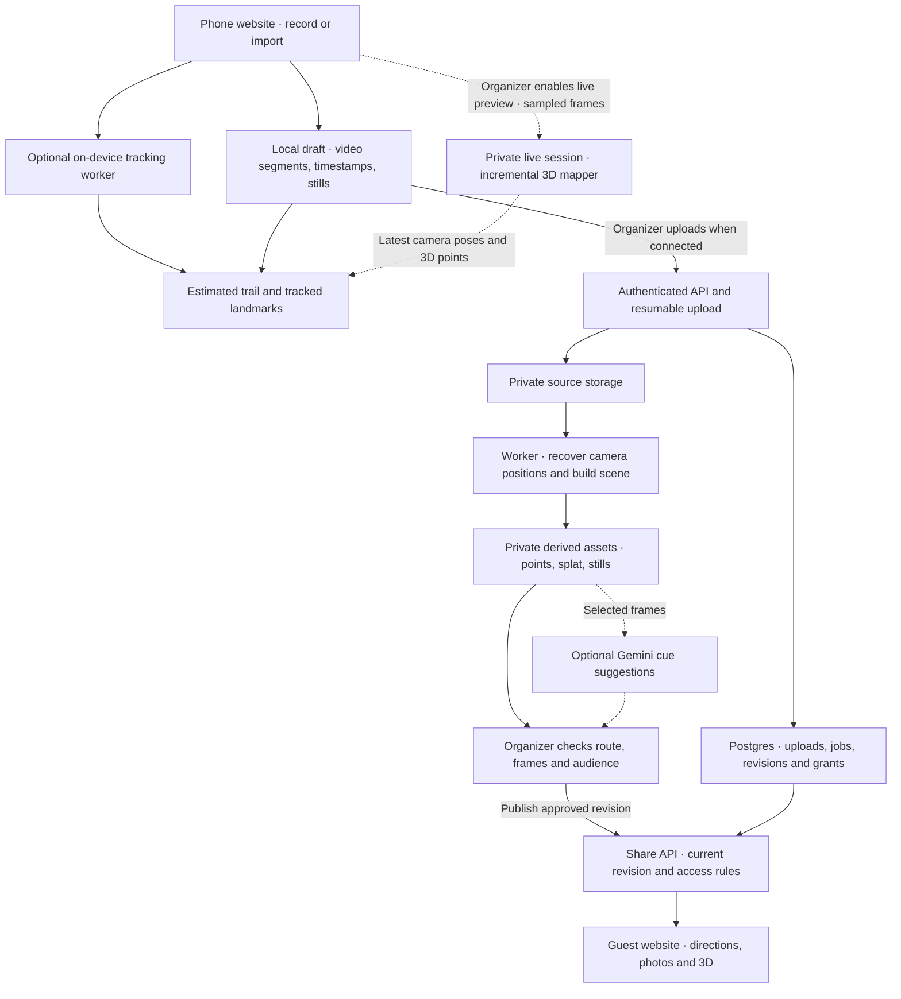

# Path from an offline phone scan to a shareable place

**Product plan · Anish and Krishna own capture and reconstruction, Sam owns ingest and access, and Arielle owns the organizer and guest website.** The first release covers one permitted venue section with a recognizable turn. An organizer can record it on an ordinary phone in airplane mode, check the capture before leaving, and upload later. A visitor can open a link or QR code, recognize the same turn, and follow an organizer-approved direction. Both use a website.

**The product decision.** Save the original recording on the phone in both capture modes. Let the organizer choose an on-device preview or a live, server-assisted 3D preview and switch during a walk. Use a worker for each active live session and build the final shareable scene once per accepted source revision. Give guests a small photo-and-text route alongside the interactive 3D view. Those three choices let weak connectivity, a modest phone, or a failed GPU job affect one part of the experience without costing someone their recording or directions.

**Starting evidence.** The repository has a synthetic venue and a local PLY/GLB sharing API. Arielle reported rendering the unlisted fixture and exercising organizer upload in desktop Chromium at phone width. The separate ARKit experiment exercised a simulated device and synthetic export. The camera-only offline capture, physical phone walkthrough, real video reconstruction and hosted sharing described below are proposed device trials. [Guest viewer checkpoint](https://github.com/darkprince558/path-app/issues/2#issuecomment-7057388724) · [Organizer upload checkpoint](https://github.com/darkprince558/path-app/issues/13#issuecomment-7057554875) · [Capture checkpoint](https://github.com/darkprince558/path-app/issues/4#issuecomment-7057179801)

The [engineering blueprint](../docs/web-scan-engineering.md) gives the build team the library list, deployment boundaries, live session protocol, persistent records, API handoffs, capacity worksheet, and implementation gates.

## What each person experiences

| Person | What Path should let them do |
| --- | --- |
| Organizer with a newer phone | Open the scanner once online, see **Ready for offline capture**, then record a junction with the rear camera. Check the estimated camera trail and saved landmark frames. Walk back and capture a missed doorway while still there. |
| Organizer with a usable connection | Turn on **Live server preview** to send selected frames while walking. See matched 3D points accumulate around the doorway. Switch back to **On-device preview** at any time and keep the same recording. |
| Organizer with an older phone, denied sensors, or no advance visit | Use camera-only recording and inspect the saved frames. If opening Path for the first time with no signal, use the phone camera and import that video when Path is available. Capture can start before sign-in. Publishing requires the organizer’s account. |
| Visitor at an entrance | Scan the QR or open the short link, choose a destination, and immediately read the next turn with an approved landmark photo. Tap **Explore in 3D** to inspect it from another angle. An unlisted link opens signed out. |
| Visitor with limited data, motion sensitivity, or assistive technology | Read the same ordered directions in HTML. Zoom a still, use labeled Previous/Next buttons, and choose to load 3D. Keep destination selection and the route usable with keyboard and screen reader, without dragging, autoplay, or an orientation lock. [WCAG guidance](https://www.w3.org/WAI/WCAG22/quickref/) |

## Architecture



### 1. Make the phone a dependable field recorder

- Serve the scanner over HTTPS. On an online visit, a service worker caches a versioned capture page and its local dependencies, including the tracking module if supported. Show offline readiness after the files and local write check succeed. Make the capture page reachable on offline reload without an account refresh. A first-time visitor in a dead zone can still bring back an ordinary video. [Camera access](https://developer.mozilla.org/en-US/docs/Web/API/MediaDevices/getUserMedia) · [Service workers](https://developer.mozilla.org/en-US/docs/Web/API/Service_Worker_API/Using_Service_Workers)
- Request only the rear camera for basic capture. Negotiate the recording format at runtime and preserve its real MIME type and orientation for the worker. Write numbered chunks to IndexedDB (browser storage) as they arrive, with a local draft ID and an ordered manifest. At intentional pauses and section boundaries, finalize independently playable segments. Set **Saved on this phone** only after the recorder flushes and the storage transaction commits. Individual recorder chunks can depend on earlier chunks. After a crash, recover completed segments and report the recoverable duration of the last segment. [MediaRecorder specification](https://www.w3.org/TR/mediastream-recording/) · [Chunk delivery and browser interruptions](https://developer.mozilla.org/en-US/docs/Web/API/MediaRecorder/dataavailable_event)
- Check available space, request persistent storage where supported, and offer **Save video copy** on completion. Handle write failures while the recorder is open, stop cleanly, and display the last confirmed saved segment. Give users a draft list with duration, thumbnail, upload status, export, and delete. Keep the original until the server confirms receipt and the organizer chooses to remove it. Cache the scanner separately from guest assets. [WebKit storage and eviction](https://webkit.org/blog/14403/updates-to-storage-policy/)
- Give one practical framing prompt: walk around the corner, include the same doorway from multiple positions, and hold briefly on the readable sign. Save representative stills with timestamps so the organizer can inspect them even on a slow phone. A blank wall or turning in place supplies poor evidence for recovering depth. [COLMAP capture guidance](https://colmap.github.io/tutorial.html)

### 2. Show an honest offline preview

Run tracking on downscaled frames in a worker and let stale preview frames drop if recording falls behind. Prototype the camera-and-motion-sensor path with `visloc-rs`, whose browser demo exposes phone tracking and landmarks. Test another camera-only tracker or ship frame review when motion permission, calibration, compute, or sustained tracking is insufficient. Camera capture, local storage, and later upload must work independently of the tracker. [Browser tracking prototype](https://rsasaki0109.github.io/visloc-rs/slam/)

Show the camera trail, reliable tracked landmarks where available, and thumbnails pinned to their estimated capture positions. Label tracking loss immediately. Preserve separate trail segments until alignment is recovered, and invite the organizer to revisit the last clear doorway. A blank area in a sparse map can be a smooth wall or missing coverage. Let the organizer inspect an actual image before deciding to rescan. First-release guests get directions from a known entrance and approved waypoints. The offline trace is a capture aid and cannot certify a walkable path, a distance, or live guest position.

### Live server preview during the same recording

Offer **On-device preview** and **Live server preview** before recording and while it is running. Default to on-device for a new scan. When someone selects live, explain that selected camera frames go to Path’s server for a private preview. Use the connection they choose whenever it can sustain timely updates, including cellular. Joining a Wi-Fi network alone leaves their selection unchanged.

1. Sam’s API opens a private, authenticated session tied to the local draft. The recorder keeps saving the original at capture quality. In parallel, send selected, downscaled frames with stable IDs, timestamps and orientation over a secure WebSocket. Start at a few frames per second and tune using measured frame-to-display delay and buffered bytes. Drop stale preview frames when congested. On a slower phone, keep frame review available while the server does the mapping. [Browser send-buffer API](https://developer.mozilla.org/en-US/docs/Web/API/WebSocket/bufferedAmount)
2. A worker holds the map for the session, matches overlapping views and triangulates points as the camera moves. Prototype an incremental PyCOLMAP integration using the gate 1 clip replayed at walking speed. Return versioned poses and colored 3D point updates so the scanner can rotate the growing map and see when the turn registers. Start with sparse geometry. Trial a dense GPU mapper if user tests show that people need more surface detail to spot a missed doorway. [PyCOLMAP mapping API](https://colmap.github.io/pycolmap/pycolmap.html)
3. A dropped link, stalled worker or busy server switches the display to the on-device trail or saved frames. Mark the server map with its last update time. Reconnect within the same opted-in session and align new points using recent overlapping views. If alignment fails, show separate sections until the mapper connects them. Switching off live explicitly stops transmission, drops queued frames and keeps automatic reconnect disabled. Selecting live later starts with newly captured views.
4. Finishing a scan closes the live session and keeps the completed draft on the phone. The organizer chooses whether to upload the original and whether to publish the resulting scene. Keep live frames and derived geometry private and temporary, expire disconnected sessions after a bounded idle period, and release computing capacity. Ignore stale session updates after a switch. Measure live worker minutes per active scanner separately from final reconstruction cost per published scene.

### 3. Resume upload and build the scene once

1. When the organizer taps **Upload**, bind the draft to their authenticated account and create a resumable upload. Use a self-hosted tus endpoint and private object storage. Persist the upload ID against the local draft. On reconnect or foreground reopen, query the server’s confirmed offset, then send remaining bytes. If credentials expire, reauthenticate and rebind to the same authorized upload. A switch of account asks which draft to claim before sending bytes. [tus protocol](https://tus.io/protocols/resumable-upload)
2. Validate source size, media type, decodability, duration, and checksum. Include real iPhone MOV/MP4 and Android WebM/MP4 samples, portrait rotation, and variable frame rate in decoder trials. Preserve the local original and explain how to retry or import another file if a codec fails. Create one job per source revision and processing recipe. Duplicate finalization, late writes, or worker retries converge on one committed result. Keep partial outputs in staging and keep the previous published revision available. A failed job offers retry, source replacement, or a photo route the organizer can review.
3. Decode sharp, overlapping keyframes and retain stable frame IDs and timestamps. Start with PyCOLMAP to estimate camera positions and produce a colored PLY. Check that approach, junction and exit belong to one plausible reconstruction. Set metric scale using a measured reference and verify against a second distance before publishing measurements. Confirm handedness and turn direction in the shared event frame (+Y up, entrance facing −Z). Record drift or disconnected sections. [COLMAP](https://colmap.github.io/tutorial.html) · [Venue contract](../fixtures/README.md)
4. When the sparse reconstruction covers the turn, reuse the posed frames to train a Gaussian splat for photorealistic exploration. Start with Brush on the team Mac for the first clip. A queued Linux GPU worker using gsplat is a candidate when repeatable timings or concurrent jobs justify it. Start with a bounded worker count and a processing budget per revision. A verified route can publish with its photos while a richer scene is processing. Keep **3D ready** as a separately measured result. [Brush](https://github.com/ArthurBrussee/brush) · [gsplat training example](https://docs.gsplat.studio/main/examples/colmap.html)
5. Keep web delivery and GPU capacity separate. Use the [proposed web/API host](../docs/deployment.md), Postgres, a private object bucket, and a durable job queue. A database-backed queue with a worker lease and heartbeat is enough to start. An EC2 G6 with an NVIDIA L4 is one hosted benchmark candidate. Compare reconstruction time, queue wait, cost per **usable** scan, and cross-provider transfer costs before selecting a host. Capacity for live mapping follows opted-in concurrent scanners. Reserve a separate worker budget for final reconstruction so live sessions cannot starve uploads awaiting processing. Guest traffic uses the published assets, with ranges or levels of detail for larger scenes. [AWS G6 specifications](https://aws.amazon.com/ec2/instance-types/g6/) · [Spark level of detail](https://sparkjs.dev/docs/lod-getting-started/)

### 4. Review, publish and navigate

The organizer selects the entrance, names destinations, connects verified walkable edges, checks the landmark and direction, and previews the guest experience. Gemini can suggest a cue from specifically selected frames after upload. Bind every suggestion to a frame, route direction, and revision. The organizer can edit or write the cue manually. Step-free routing requires verified access information for every edge in the route. If an entrance is closed or the graph is disconnected, show that state and an available verified alternative. Later contributions align to organizer-confirmed anchors and become visible after revision approval. [Gemini workflow](../docs/gemini-demo.md) · [Sharing and event architecture](../docs/architecture.md)

Use private drafts by default. Keep original footage, processing logs and rejected frames owner-only. Before publishing, let the organizer exclude sensitive frames and withhold a scene that still depicts people or private signage. Removing a still does not remove its pixels from a trained scene. Redact affected source frames and rebuild, or publish just the approved route. Recheck Public, Unlisted and Private access on every manifest, photo, splat tile and direct asset request. Scope private caches by access or bypass shared caching. A revoked viewer loses subsequent access. Explicitly downloaded copies may remain. Provide source and publication deletion, cancel outstanding work on deletion, and define raw-media retention with the venue owner before a pilot.

Guest pages serve lightweight HTML directions first. Fetch a small approved still for the current step, then load the 3D renderer on demand. Try Spark for splats and retain the existing point/mesh renderers. If graphics initialization fails, the visitor stays on the same route and step. Design the venue QR for a known entrance and include its text URL. For disconnected guest visits, offer an explicit download of organizer-approved directions and photos ahead of time. Label the revision and download date. Begin with public route packs the organizer enables for download. Private directions stay online for access checks. A first-time visitor at a fully offline entrance can use posted physical directions or a venue-provided local network in a later deployment.

## Hiking trails and downloaded routes

For a hike, show one reviewed trail line from the trailhead to the destination. Attach short 3D scenes at forks, bridges, entrances, or lookouts where seeing the approach helps someone choose a branch. Film both branches from overlapping positions, including a durable landmark such as a sign, bridge or rock. The existing capture, live preview, delayed upload and rendering pipeline can process each clip independently.

The mapper can select **Record location with video**. Show whether a fix has actually been saved, how old it is, and the phone’s reported accuracy. A marker at a fork lets the mapper open the corresponding moment in the clip. They can also mark a fork manually when a fix is missing. For a continuous trail line from several short videos, offer a separately selected **Record the route between clips** mode with a visible stop control. Where a route segment is missing, the organizer can supply a verified track or leave a visible gap.

Before setting out, a hiker downloads an organizer-enabled public route pack containing the reviewed line, junction waypoints, directions, photos and optionally selected 3D scenes. Include the pack size, revision and last review date. Cache an offline-licensed basemap with attribution if available, and retain a simple route diagram when tiles are unavailable. Verify the pack before marking it ready. The hiker can open it in airplane mode without granting location access. If they choose to show their current position, draw its accuracy radius locally. When that radius overlaps both branches, use the junction photo and sign to identify the turn. A closure discovered after download requires a later refresh. [Trail navigation and offline map guidance](https://www.nps.gov/grsm/planyourvisit/gps.htm) · [Location and video contract](../docs/web-scan-engineering.md#recording-location-alongside-video)

**Outdoor acceptance trial.** Krishna and Anish record a permitted wooded fork with the website already cached, first under open sky and then under canopy. Pause, resume and mark the fork on camera. Recover the draft offline and confirm that selecting the marker opens the right clip and moment. Arielle and Sam verify the approved pack, then give a second person a phone in airplane mode. Can they identify the correct branch using the downloaded map and photo, even with location denied and 3D disabled? Record fix gaps, accuracy, marker timing error and observed turn on iPhone Safari and Android Chrome. This is a proposed trial.

## The first producer-to-consumer agreement

Arielle, Sam, Krishna and Anish can exercise this synthetic example before choosing a GPU host. Use the existing finished-model upload and `/s/<shareId>` route for the first physical 3D check. Add a separate ingest path for video. Extend guest metadata additively, retaining `format` and `assetPath` for existing PLY/GLB clients. For an enhanced viewer, specify the representation independently of the filename. A colored point PLY and a splat PLY require different renderers. The following is an **illustrative proposed guest response** for an unlisted, approved revision. The original video and upload URL stay outside it. [Current API contract](../services/api/README.md)

```json
{
  "shareId": "example-turn",
  "format": "ply",
  "assetPath": "/api/shares/example-turn/asset",
  "revisionId": "r1",
  "scene": { "kind": "pointCloud", "assetPath": "/api/shares/example-turn/asset" },
  "steps": [{
    "waypointId": "junction",
    "instruction": "Turn left at the amber doorway.",
    "photoPath": "/api/shares/example-turn/revisions/r1/photos/junction"
  }]
}
```

When a splat becomes available, add it as a distinct authorized rendition with `kind: gaussianSplat` and its own path. Keep the legacy `assetPath` tied to its announced format and representation. A route published with photos alone has its own explicit capability and only goes to clients supporting that response. Retain the same share link across approved revisions. Store upload progress, processing status and publication state independently. For example, a visitor can read published revision `r1` while the owner sees that `r2` is processing. Geometry, approved frames, and waypoints switch together when the organizer publishes `r2`.

## Delivery order and release gates

| Priority | Owners and dependencies | Verifiable outcome |
| --- | --- | --- |
| **1. One real video to one shared 3D turn** | Krishna + Anish record a permitted L-shaped corridor with an ordinary phone, a distinctive doorway and two measured references. Sam and Arielle reuse the upload/viewer work. Start with one worker invocation on the Mac. [Capture #4](https://github.com/darkprince558/path-app/issues/4) · [Viewer #2](https://github.com/darkprince558/path-app/issues/2) | A signed-out teammate on a second physical phone opens an unlisted link over cellular, orbits the real scan, and identifies the turn. If sparse points obscure it, try the splat on the identical clip. Record device, time, bytes and recognition result. This is the 3D milestone. |
| **2. Offline recording through delayed publication** | Arielle owns the browser flow, Krishna + Anish supply capture and processing, Sam connects resumable uploads and job state. The viewer can already consume the resulting asset. [Ingest #3](https://github.com/darkprince558/path-app/issues/3) · [Organizer #13](https://github.com/darkprince558/path-app/issues/13) | Prime the site, record in airplane mode, finish, close the tab and recover the draft offline. Reconnect, sever an upload halfway, resume, restart the worker once and publish one result. Repeat on physical iPhone Safari and Android Chrome. |
| **3a. On-device preview and inclusive guest route** | Krishna + Anish benchmark local tracking. Arielle adds trail, frame review, HTML steps and the optional splat viewer. Sam exposes approved renditions. Start the trail experiment alongside gate 1 using the same clip. | On a supported phone, verify that real camera motion produces an offline 3D trail through both legs and tracking loss is visible. Have a scanner inspect the corner and decide whether to recapture it. A new visitor follows the verified turn using 3D. Another completes the same route using directions and stills with the renderer disabled. Test the route with a screen reader. [Second-phone trial #5](https://github.com/darkprince558/path-app/issues/5) |
| **3b. Optional live server preview** | Sam owns session transport and limits, Krishna + Anish own incremental mapping, and Arielle owns the mode switch and map. Replay the gate 1 clip first, then use the same corridor on physical phones. | Verify the doorway appears in 3D before Finish. Disable the connection mid-turn, restore it, then switch off live manually. Confirm a continuous local recording, recovery of the live map or an explicit alignment gap, and zero new preview frames sent after opt-out. |
| **4. Public pilot** | Sam owns access, deletion and worker recovery. Arielle owns accessibility and route review. Anish and Krishna qualify more sites/devices. Depends on gates 1 through 3b. | Exercise all three sharing modes, a venue closure, an unreachable destination, a queue backlog, and deletion during processing. Publish only the supported device/feature combinations that passed. Measure cost and completion by device tier and connectivity. |
| **5. Grow the venue** | After one section works end to end, add approved multi-section contributions, destination search, downloadable public route packs, localized cues and verified step-free alternatives, guided by pilot use. | A returning visitor follows the same link to an approved revision. A contributed or closed section changes only the intended routes. The visitor can tell when a downloaded route was last updated. |

**Demo cut.** Start the turn with live server preview, disconnect while filming and inspect the local draft in airplane mode. Reconnect, resume the upload, and open the same doorway on a second phone. If fitting the splat takes longer than the presentation, show the new job’s real status and open a labeled previously completed reconstruction of the same capture. If only the photo route or desktop browser works, report that precise outcome. The first implementation handoff is an approved clip held privately, the worker’s colored PLY, frame IDs for approach/junction/exit, scale evidence, and a small synthetic equivalent for CI.

## Qualification matrix

| Stress case | Expected behavior | Evidence to record |
| --- | --- | --- |
| Unprimed offline visit, denied camera or motion, in-app browser | Explain the available action: record with the phone camera for later import, open in the system browser, or continue camera-only. Visitors can read a published route without granting device permissions. | Walk each entry path with a fresh browser profile. |
| Low memory, slow phone, heat, low storage or private browsing | Reduce preview work first. Offer standard recording/import or export if local persistence fails. Preserve already finalized segments. | On an older physical phone, record a full section, reopen and play it. Induce a storage-write failure and verify the last saved segment. |
| Tab closed, phone locked or interrupted, site updated mid-draft | On return, recover completed segments and show gaps or interrupted status. A scanner update can still read the previous draft format. | Compare recorded and recovered duration. Try a normal stop and a forced interruption separately. |
| Live mapper saturated, Wi-Fi present without internet, or delayed map update | Show the last preview time and keep recording. When the user turns off live, keep subsequent frames on-device. | Compare recording duration across a network cut, CPU/GPU overload and mode switches. Measure preview age on the phone and test a late update from an old session. |
| Slow link, duplicated finalization, expired session, worker killed | Resume from confirmed bytes, preserve the local source, deduplicate jobs, retain the current published revision. | Confirm one completed source/revision, byte totals, and correct permissions after retry and restart. |
| Blurry sign, repetitive doors, glass, crowds, detached map sections | Show source photos and tracking quality and prompt for another view. Recheck alignment after re-recording. A reviewer approves a route only for the connected section they verified. | Compare against the real turn and two measured references. Record which views failed and the organizer’s decision. |
| Low bandwidth, WebGL failure, large text, reduced motion, keyboard or screen reader | Offer the same destinations and directions in text and photos. Keep touch and keyboard controls labeled and preserve focus and step when changing views. | Complete the route in Safari/VoiceOver and Android/TalkBack, plus a keyboard-only desktop check. Try disabling graphics and throttling the network. |
| Access revoked, unsafe photo, venue reroute or deletion | Enforce access on direct files and tiles. Remove deleted publications, reject stale jobs, and direct guests to the approved revision. | Test Public → Unlisted → Private, an invited guest before/after revocation and the old asset URLs. Verify a job finishing after deletion cannot republish. |

**Operate the pilot.** Track counts of drafts recovered in a consented device trial, uploads resumed, usable scenes produced, and visitors who reach the right turn. Track queue age, processing failures by stage, peak memory, asset bytes, and mobile load time at the median and 95th percentile when sample size permits. On a surge, keep serving existing revisions, queue new jobs fairly per organizer, show the wait, and stop retrying persistently bad inputs. Before scaling workers, count GPU minutes including failed attempts and divide the spend by usable published scenes.

**Proposed pilot targets.** Start with a 30–60 second corridor capture. Target visible feedback within two seconds after initialization. For the server path, measure from the contributing frame’s capture timestamp to display on the same phone, including upload, queuing, mapping and return traffic. Record median and 95th percentile on venue Wi-Fi and cellular. Aim to display the first readable directions within three seconds on a documented 1.5 Mbps connection. An offline capture should survive a normal stop, close and reopen on both target phone families. In five independent visitor trials, aim for at least four to recognize and take the right turn without help. Record which view each used. Measure 3D time-to-interaction separately from directions load, and report queue, reconstruction, output size and worker cost separately. Treat these as design targets until device evidence exists. Expand device support based on real completion rates, with scan content and private venue imagery excluded from analytics.
